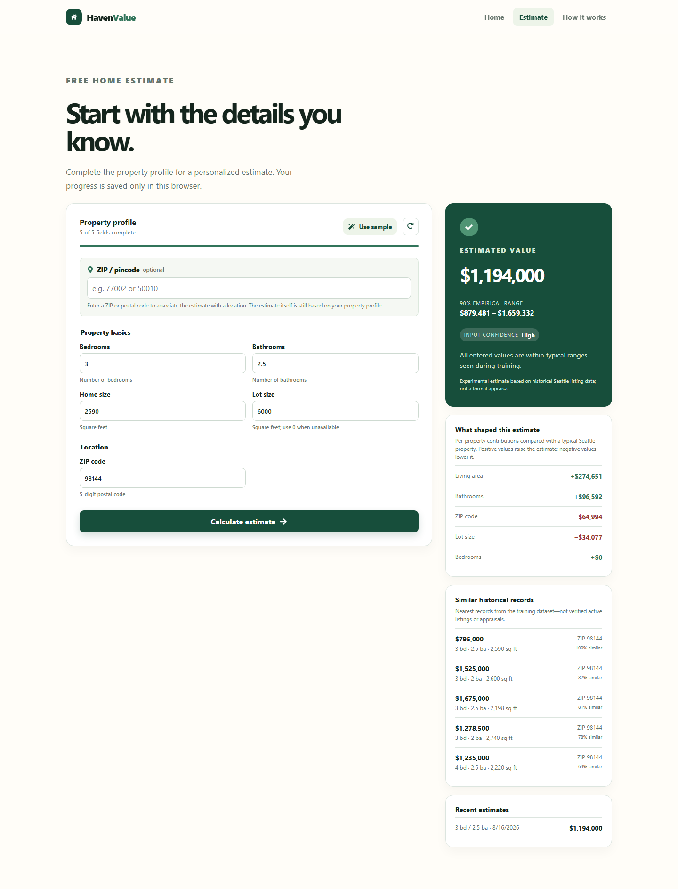
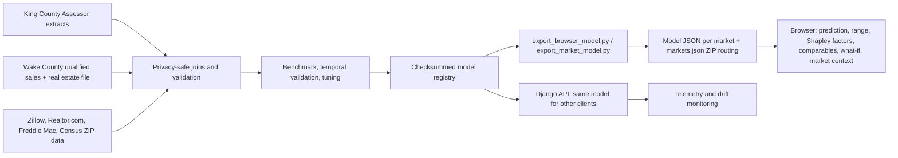

# HavenValue — home-price estimates for Seattle and Wake County, NC, computed in your browser

[](https://github.com/vinayakraju16/House-Price-Prediction/actions/workflows/ci.yml)

**Live demo: [house-price-prediction.vinayakraju.dev](https://house-price-prediction.vinayakraju.dev)**

HavenValue estimates the sale price of a home from its size, location, quality and age. The ZIP
code picks the market model:

| Market | Training data | Model | Holdout median error |
|---|---|---|---:|
| **Seattle** (King County, WA; ZIPs 98101–98199) | 84,965 King County Assessor sales, 2015 – Oct 2026 | 3.1.0, gradient-boosted trees | 9.8% (2026 sales) |
| **Wake County, NC** (38 ZIPs) | 36,386 county-qualified sales, Oct 2024 – Oct 2026, plus ZIP market data | wake-county-1.0.0, gradient-boosted trees priced relative to the ZIP's Zillow home value index | 7.8% (Apr–Oct 2026 sales) |

Everything runs **entirely in the visitor's browser**: the deployed site is a static Cloudflare
Workers app with no backend, and every estimate comes with:

- a measured 90% price range;
- a per-feature explanation of what drove the price;
- the five most similar historical sales;
- live "what-if" sliders that re-price the home as you drag;
- in Wake County, the ZIP's latest market conditions (Zillow home value and trend, days on market,
  price cuts, mortgage rate).



## Highlights

- **Real data, privacy-safe.** Seattle joins the county's sales, residential-building and parcel
  extracts; Wake County joins its appraiser-reviewed qualified sales with the fixed-width real
  estate file. Owner names, addresses and recording numbers are never read
  ([`ml/data/king_county.py`](ml/data/king_county.py), [`ml/data/wake_county.py`](ml/data/wake_county.py)).
- **2026 market data, tested before trusting it.** Zillow ZIP home values, Realtor.com ZIP
  inventory, Freddie Mac mortgage rates and Census ZIP income are joined with a one-month lag
  ([`ml/data/market_features.py`](ml/data/market_features.py)). An ablation on later sales showed
  that inventory and rate inputs *hurt* (they encode when a sale happened, which shuffled CV had
  hidden), while ZIP income helps. The Wake model is trained on price relative to the ZIP's Zillow
  index, so estimates follow the local market at each monthly refresh without retraining
  ([`reports/MARKET_FEATURES_2026.md`](reports/MARKET_FEATURES_2026.md)).
- **Target leakage caught and fixed.** An earlier model reported R² 0.957, but two of its features
  were computed from the sale price itself. Measured the way the API actually runs it, it scored
  R² 0.499. It was retired and rebuilt
  ([`reports/PRODUCTION_MODEL_AUDIT.md`](reports/PRODUCTION_MODEL_AUDIT.md)).
- **Honest evaluation.** Models are chosen by 5-fold cross-validation grouped by parcel, so the same
  house never appears in both train and test. They are then scored on an untouched **2025–2026
  temporal holdout: R² 0.832, MAE $149k**. Errors on luxury homes are reported, not hidden
  ([`reports/MODEL_EVALUATION.md`](reports/MODEL_EVALUATION.md)).
- **Serverless inference with verified parity.** The fitted scikit-learn pipeline is exported to
  JSON and re-implemented in JavaScript. It matches scikit-learn to within 2×10⁻¹⁶ relative error
  on 21,786 homes, and a CI test fails if they ever diverge. Hosting cost: $0.
- **Explainable by default.** Each estimate includes 128-path permutation-Shapley contributions
  that add up exactly to the prediction, plus nearest comparable sales.
- **Production engineering.** The repo includes:
  - a checksummed model registry with rollback and versioned metadata;
  - a reproducible training CLI and optional MLflow tracking;
  - a Django API with request telemetry and drift monitoring;
  - Docker Compose, with an optional PostgreSQL setup;
  - GitHub Actions CI running Ruff, ML unit tests, Django tests on SQLite and PostgreSQL, ESLint,
    Vitest, and Playwright browser tests.

## Architecture



Training is an explicit offline step. The website never calls a server: Vite ships each market's
model as two lazily loaded JSON files (~1–2 MB, much smaller gzipped) that the browser downloads
only for the market of the ZIP being estimated. The Django API serves the same registered artifact for other
clients and for the Docker Compose stack.

## Results

### Wake County, NC

Chosen on a time-ordered validation (train before 2026, validate Jan–Mar 2026) and scored once on
9,206 untouched sales from Apr–Oct 2026: **MAE $70,361, R² 0.823, median error 7.8%, 61% within
10%** of the sale price; new construction 5.7% vs resales 8.5%. Full ablation in
[`reports/WAKE_COUNTY_MODEL.md`](reports/WAKE_COUNTY_MODEL.md).

### Seattle 3.1.0 (October 2026 refresh)

The county's October 2026 extracts added 1,238 sales after the previous model's data ended
(2026-07-22). On those unseen sales the previous 3.0.0 model had a 10.6% median error; the same
tuned recipe, evaluated on 2026 sales it was not trained on, has 9.8%. 3.1.0 is that recipe refit on
every sale through 2026-10-13 ([`ml/training/refresh_king_county.py`](ml/training/refresh_king_county.py),
[`reports/king_county_refresh.json`](reports/king_county_refresh.json)).

### Seattle model selection (3.0.0 recipe)

Model selection uses 5-fold `GroupKFold` by parcel. Parcels that appear in the 2025–2026 holdout
are excluded from development data.

| Model | CV MAE | CV R² | Holdout MAE | Holdout R² |
|---|---:|---:|---:|---:|
| Dummy median | $313,828 | −0.049 | $475,038 | −0.340 |
| Ridge (all features, log target) | $121,200 | 0.778 | $247,544 | 0.526 |
| Gradient boosting (5 basic fields) | $184,794 | 0.653 | $309,168 | 0.534 |
| Random forest (all features) | $125,060 | 0.774 | $179,562 | 0.763 |
| Gradient boosting (all features, log target) | $104,563 | 0.832 | $152,425 | 0.828 |
| **Same, after a 12-trial tuning search — deployed** | — | — | **$149,333** | **0.832** |

The tuning search improved CV RMSE from $214,331 to $210,053.

The 90% price range comes from holdout residual quantiles, and its measured coverage on the
holdout is 90.0%. Homes above $2M remain the hardest segment (holdout MAE $530,899). See
[`reports/MODEL_EVALUATION.md`](reports/MODEL_EVALUATION.md) for error by price band.

## How the in-browser model works

[`ml/training/export_browser_model.py`](ml/training/export_browser_model.py) reads the registered
pipeline and writes out its fitted parameters:
- median imputation values;
- standard-scaling means and scales;
- one-hot categories;
- every node of all 400 trees.

It also writes the bundled comparable sales and the fixed Shapley permutations.
[`frontend/src/model/predictor.js`](frontend/src/model/predictor.js) repeats each pipeline step
with the same floating-point operations. It also ports the API's validation rules and error
messages, so the site behaves exactly like the former `/predict/` endpoint.

Parity is checked three ways:
1. scikit-learn's own `predict`;
2. an independent Python evaluator that reads only the JSON;
3. the JavaScript, against
   [fixtures](frontend/src/model/__fixtures__/parity-3.1.0.json) scored by the backend's own
   explanation and comparable-search functions.

## Markets

The estimate page picks a model from the ZIP code (`frontend/src/model/markets.json`):

| Market | ZIPs | Model | Browser runtime |
|---|---|---|---|
| Seattle (King County, WA) | 98101–98199 | 3.1.0, assessor sales through 2026-10-13 | `predictor.js` |
| Wake County, NC | 38 ZIPs in the county's qualified sales | wake-county-1.0.0, priced relative to the ZIP's Zillow home value index | `marketPredictor.js` |

Wake County has no bedroom count, so its form has no bedrooms field; its estimate also shows
the ZIP's latest market conditions. Market data sources and findings:
[`reports/MARKET_FEATURES_2026.md`](reports/MARKET_FEATURES_2026.md),
[`reports/WAKE_COUNTY_MODEL.md`](reports/WAKE_COUNTY_MODEL.md).

## Run it locally

The website needs only Node.js 22.13+:

```powershell
cd frontend
npm ci
npm run dev          # http://localhost:3000
```

For the full stack (Django API, Nginx, SQLite) with Docker:

```powershell
docker compose up --build --detach --wait --wait-timeout 180
# App: http://localhost:3000   API health: http://localhost:8000/health/   Readiness: http://localhost:8000/ready/
docker compose down
```

A validated PostgreSQL override is available with
`docker compose -f docker-compose.yml -f docker-compose.postgres.yml up --build`. Backups are
documented in [`reports/DEPLOYMENT.md`](reports/DEPLOYMENT.md).

To run the backend without Docker (Python 3.10, using the pinned scikit-learn 1.4.2):

```powershell
py -3.10 -m venv venv
.\venv\Scripts\python.exe -m pip install -r requirements.txt
.\venv\Scripts\python.exe backend\manage.py migrate
.\venv\Scripts\python.exe backend\manage.py runserver
```

## Retraining

Place the county's `Real Property Sales.zip`, `Residential Building.zip` and `Parcel.zip` under
`data/raw/king-county/` (Git ignores them), then run:

```powershell
.\venv\Scripts\python.exe -m ml.data.king_county                 # privacy-safe joined dataset
.\venv\Scripts\python.exe -m ml.training.benchmark_king_county   # grouped-CV comparison
.\venv\Scripts\python.exe -m ml.training.tune_king_county        # bounded randomized search
.\venv\Scripts\python.exe -m ml.training.train_king_county       # evaluate, fit, register
.\venv\Scripts\python.exe -m ml.training.export_browser_model --fixtures   # update the website
```

To refresh Seattle with newly published extracts (same tuned recipe), and to rebuild Wake County
(see `data/README.md` for the Wake and market files):

```powershell
.\venv\Scripts\python.exe -m ml.data.king_county
.\venv\Scripts\python.exe -m ml.training.refresh_king_county --register   # evaluate, register, export
.\venv\Scripts\python.exe -m ml.data.wake_county
.\venv\Scripts\python.exe -m ml.training.train_wake_county                # ablation, tuning, model
.\venv\Scripts\python.exe -m ml.training.export_market_model --fixtures   # Wake browser files
```

The registry ([`backend/mlmodels/model_registry.json`](backend/mlmodels/model_registry.json))
records SHA-256 hashes, and Django verifies them before loading a model. Set `MODEL_VERSION` to
pin or roll back the API. MLflow tracking is optional (`requirements-mlflow.txt`) and never
imported at inference time.

## Repository layout

| Path | Contents |
|---|---|
| `frontend/` | React 18 + Vite app, in-browser model (`src/model/`), Vitest and Playwright tests |
| `ml/` | Data preparation, feature pipelines, benchmarking, tuning, training, export |
| `backend/` | Django API, model registry (`mlmodels/`), monitoring, request telemetry |
| `reports/` | Evaluation, benchmark, leakage audit, operations and deployment notes |
| `docs/` | Screenshots and project/deployment audit write-ups |
| `data/Seattle/` | Small legacy dataset behind the `seattle-ridge-v1` rollback model and the original five-field pipeline |

## API (optional backend)

`POST /predict/` takes `beds`, `baths`, `size`, `lot_size` and `zip_code` (98101–98199). It also
accepts optional building details: `stories`, `grade`, `condition`, `year_built`,
`year_renovated`, `finished_basement_sqft`, `garage_sqft`, `fireplaces`, `has_view`,
`heat_system` and `property_type`. Omitted fields use the training defaults.

The response contains:
- `prediction`;
- the 90% `range`;
- input `confidence`;
- `top_factors` (Shapley contributions);
- five `comparables`.

Invalid input returns HTTP 400 with field-level `details`.

`GET /monitoring/?days=7` reports request counts, error rate, latency percentiles, the prediction
distribution, and an input-drift signal; send `X-Monitoring-Key` outside development
([`reports/OPERATIONS.md`](reports/OPERATIONS.md)). A separate, experimental Harris County (Texas)
appraisal-value model is served at `/harris-schema/` and `/predict-harris/`
([`ml/HARRIS_COUNTY.md`](ml/HARRIS_COUNTY.md)).

## Testing

```powershell
.\venv\Scripts\python.exe -m unittest discover -s ml\tests -v
.\venv\Scripts\ruff.exe check backend\api backend\djanoproject backend\model_runtime ml\data ml\features ml\training ml\evaluation ml\tests
cd backend; ..\venv\Scripts\python.exe manage.py test api; cd ..
cd frontend; npm run lint; npm test; npm run build
```

CI ([`.github/workflows/ci.yml`](.github/workflows/ci.yml)) runs these checks plus the PostgreSQL
Django suite and Playwright end-to-end tests against the Docker Compose stack.

## Limitations and next steps

- **One range for every home.** The price range has the same width for every house. Quantile
  models would give a $3M home a wider range than a $500k condo.
- **No precise location.** The model knows only the ZIP code, not latitude/longitude or
  neighbourhood. Location features are the likeliest way to cut the large errors on luxury homes.
- **Model comparison.** A LightGBM/CatBoost comparison and a market-index adjustment for older
  sales are natural extensions.
- **Not an appraisal.** Comparables are historical assessor sales, not live listings or verified
  appraisal comparables.
